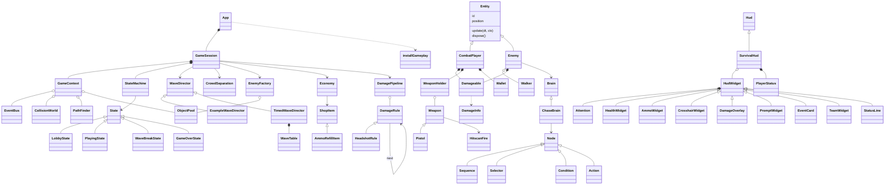

# 玩法骨架

這一版建立共用契約，以及 `Pistol`、`Walker`、`AmmoRefillItem` 最小範例，並已加入 `Rifle`、`Shotgun`。其他敵人、商品、章節任務與多人連線列在 [TODO.md](../../TODO.md)，照下面的步驟擴充，不把舊 prototype 整套搬回來。

## 啟動與範圍

```text
npm run serve
http://localhost:8080/web/index.html?level=ch2&play=1
```

- 只有 **`play=1`** 開啟玩法；沒有此參數、`play=0`、`play=true` 都仍是原有走動展示。
- `shot` 優先於 `play`，連 `?level=ch2&play=1&shot=gate_view` 也只拍原場景，不建立玩法實體或 HUD。
- 點畫面取得滑鼠鎖定才從 Lobby 開始。WASD 移動、Shift 跑步、左鍵開火（步槍按住連射）、R 換彈、1 手槍／2 步槍／3 霰彈槍、F 手電筒。放開左鍵、失去視窗焦點或解除鎖定會停止連射。
- Esc 解除鎖定會暫停玩法時鐘；重新點畫面繼續。不要用系統時間決定射速或換彈，以免暫停期間偷偷完成。
- 波次清空後依波次表整備 6～10 秒；靠近關卡 `type: "shop"` marker 按 E，以 $25 補滿目前武器的彈匣與備彈。波次中或離商店太遠不能買。
- 生命歸零進入 GameOver，凍結戰鬥，重新整理才重開。暫無救援、復活、獲勝／開大門條件，也不實作故事章節目標。
- 預設使用資料驅動的混合波次，陸續出怪且限制同時在場數量（見下方 G3 波次表）；數值不是最終遊戲平衡。單人離線而已，沒有網路協定。

## 類別關係



## 檔案與介面

| 位置 | 契約與責任 |
|---|---|
| `game/installGameplay.js` | 唯一玩法組合入口，建立實例、註冊範例；Three.js 灰盒外觀也在此建立，使用既有 `greybox.dummy` 顏色，沒有新增燈或陰影 |
| `game/GameContext.js` | `scene`、`collision`、`pathFinder`、`events`、`pools`、`players`、`enemies`、`rng`、`time`、`aim`、`session`；容器不是全域變數 |
| `game/GameSession.js` | 唯一模擬權威：輸入命令、傷害套用、擊殺獎金、購物限制、波次與 GameOver；App 擁有它並推進時鐘 |
| `game/states/` | 薄的 State 子類，將生命週期／更新交回 Session，使用現有 `core/StateMachine` |
| `game/WaveDirector.js` | `start(wave, ctx)`、`update(dt, ctx)` 與 `nextSpawn(ctx, reusableResult)`；`remaining` 是尚未產生的數量。基底 update 為空操作，ExampleWaveDirector 保留即時出完 2 → 3 → 4 隻 walker 的範例行為 |
| `game/TimedWaveDirector.js`、`game/WaveTable.js` | 新 director 子類以模擬時鐘控制間隔、在場上限與輪流種類；WaveTable 在建構時驗證並複製資料，依明確規則延伸後續波次 |
| `game/waves/survival.js` | 純 JS 波次資料模組，供瀏覽器和 Node 直接載入，無需額外 fetch、JSON import assertions 或 build；資料與出怪演算法分開 |
| `game/CrowdSeparation.js` | 可注入／替換的 Strategy；Session.simulate 後套用，使用兩者半徑相加的距離，透過 ctx.collision.move/hit 防止推入牆與越界，同步外觀和 hitVolume |
| `entities/Entity.js` | 可辨識的實體，`position` 是普通 `{x,y,z}` 而非 THREE.Vector3；不在匯入時啟動任何事情 |
| `entities/DamageInfo.js` | 不可變值物件：`amount`、`sourceId`、`targetId`、`hitPart`、`kind`。`withAmount()` 回傳新值，不覆寫原始傷害 |
| `entities/Damageable.js` | 組合而非多重繼承：`health`、`maxHealth`、`alive`、`takeDamage(info)`、`reset()`；傷害限於剩餘生命，每條生命只發一次死亡事件 |
| `entities/DamagePipeline.js` | 按順序串接 `DamageRule.handle/modify`，每個 rule instance 只屬於一條鏈；範例 `HeadshotRule` 為 2 倍 |
| `weapons/Weapon.js` | `fire(ctx)` 固定檢查／扣彈／策略／通知流程，子類實作 `createShot(ctx)`，可覆寫 `onFired(ctx, hit)`；冷卻與換彈都用 `ctx.time` deadline |
| `weapons/HitscanFire.js` | Fire-mode Strategy：`fire(shot, ctx, ownerId)`，輸出命中摘要或 null；只讀敵人 `hitVolume`／`headHeight` 契約，牆比敵人近就擋住子彈 |
| `weapons/WeaponHolder.js` | `add`、`switchTo`、`current`、`update`。切走的槍仍會完成換彈，切槍不重設冷卻 |
| `player/CombatPlayer.js`、`player/PlayerCombat.js` | 前者接合走動控制器、Damageable、WeaponHolder、Wallet；後者是瀏覽器輸入與重用瞄準向量，不決定命中結果 |
| `player/PlayerBody.js` | `PLAYER_BODY` 是玩家半徑 0.35 m、身高 1.8 m、視線高度 1.7 m 的單一來源，PlayerController、LevelData、PathFinder 共用 |
| `enemies/Enemy.js` | Entity 子類與 Damageable 組合，持有 Brain、重用路徑、碰撞結果與命中盒；`activate/deactivate` 為物件池生命週期 |
| `enemies/Brain.js`、`enemies/behaviour/Nodes.js` | Brain Strategy 與最小 reactive 行為樹；Sequence 遇非成功就停止，Selector 遇非失敗就停止，running 會向上傳遞；下次 tick 從首個子節點重新判斷，沒有有記憶的游標 |
| `enemies/EnemyFactory.js` | `register(type, EnemySubclass)`、`create(type, spawn)`、`release(enemy)`、`dispose()`；每種類型獨立 ObjectPool，拒絕重複註冊與重複歸還 |
| `economy/` | Wallet 驗證整數金額；Economy 控制交易並在 apply 失敗時退費；ShopItem 的 `canBuy/apply` 以多型擴充，不在 Economy 寫商品 switch |
| `ui/hud/SurvivalHud.js` | 遊戲內介面，繼承既有 Hud（`showError`、`#error`、debug/perf 顯示保留），裡面裝一組 `HudWidget`。只有 `play=1` 才建立；字型、`css/hud.css` 也是這時才加進頁面 |
| `ui/hud/HudWidget.js` 和各元件 | 每個元件一個類別、一個檔案：血量、彈藥、準星、受傷效果、提示文字、事件字卡、隊友、頂端狀態列。`bind()` 訂閱事件處理「某一刻發生的事」，`sync(status)` 收目前的數字、有變才寫 DOM；元件不持有遊戲物件 |
| `ui/hud/PlayerStatus.js` | HUD 唯一會讀 Session 的類別，每幀把血量、彈藥、金錢、波次、位置、隊友抄成普通數字。事件沒帶的數字（子彈數、是否換彈中）從這裡來；之後連線時 Client 可以用 Host 的快照填同樣的欄位 |
| `ui/hud/logic/` | 不碰 DOM 的純邏輯，各有測試：`Attention`（多久淡回去）、`HealthMeter`（低於 30% 算低血量）、`AmmoMeter`、`HitMark`、`DamagePulse`、`HitDirection`、`CardQueue`、`BrushStroke` |

### 傷害與行為的邊界

1. 武器或敵人只送出 `DamageInfo` 的 `DAMAGE_REQUESTED`，不能自己改對方的 health。
2. Session 驗證目前是 Playing、來源仍活著、目標存在、敵我不同，才套用 DamagePipeline 並呼叫目標 Damageable。
3. Damageable 發送傷害／死亡通知；Session 對自己追蹤的敵人只結算一次獎金，其他 UI／特效可訂閱通知，但不要再加一次錢。
4. 已死敵人在下一個 simulation step 歸還 Factory，重新借出時用新的 id、生命與 deadline，舊的命中不能傷害新的生命。
5. 目前 **Session 就是未來 Host 的放置點**。未來 Client 只送輸入，Host Session 決定傷害、擊殺、金錢與狀態，再傳送快照；不要讓各 Client 的 HUD 或 Weapon 各自裁定獎勵。這次不新增網路協定或連線實作。

## 設計模式對照

| 模式 | 實際位置與理由 |
|---|---|
| Template Method | `Weapon.fire` 固定開火流程，`Pistol.createShot` 提供射擊規格，`onFired` 為選用 hook |
| Strategy | Weapon 注入 fire-mode 物件，Enemy 注入 Brain，Session 注入 separation.apply(ctx) 物件；可替換行為而不用改使用者 |
| State | 四種 State 經由現有 StateMachine 管理；不能在 enter／exit 遞迴切換，要在 update 請 Session 轉換 |
| Observer | 所有玩法通知及輸入命令名稱統一在 `game/events.js`，用 App 的 EventBus 解耦 |
| Chain of Responsibility | DamagePipeline 串接 DamageRule.next，先前規則輸出交給下一個；目前只提供爆頭範例 |
| Object Pool | EnemyFactory 每種類型使用既有 ObjectPool；死亡隱藏、重設、歸還，跨波次重用 mesh 與路徑 buffer |
| Composite | `SurvivalHud` 裝著一組 `HudWidget`，每幀對每個元件呼叫 `sync` 和 `tick`；加元件不用改其他元件 |
| Template Method（介面） | `HudWidget.tick` 固定「計時的 class → 子類的 `advance` → 共用的淡入淡出」，子類只覆寫 `bind`、`sync`、`advance` |
| Factory／Registry | EnemyFactory 依字串類型建構已註冊子類；不靠大量 if/else 或匯入各種具體敵人 |

## 事件清單

全部從 `EVENTS` 匯入。命令和通知不同：命令可能被 Session 拒絕，收到 `*_REQUESTED` 不代表已成功。

| 常數 | 字串 | Payload／方向 |
|---|---|---|
| `START_REQUESTED` | `game.start-requested` | 無；輸入 → Session（僅 Lobby） |
| `FIRE_REQUESTED` | `player.fire-requested` | `{ownerId}`；輸入 → Session |
| `RELOAD_REQUESTED` | `player.reload-requested` | `{ownerId}`；輸入 → Session |
| `SWITCH_REQUESTED` | `player.switch-requested` | `{ownerId,index}`；輸入 → Session |
| `PURCHASE_REQUESTED` | `shop.purchase-requested` | `{ownerId,itemId}`；輸入 → Session |
| `DAMAGE_REQUESTED` | `entity.damage-requested` | `DamageInfo`；攻擊策略 → Session |
| `ENTITY_DAMAGED` | `entity.damaged` | `{entity,info,amount,health}`；Damageable 通知，amount 為實際扣血 |
| `ENTITY_DIED` | `entity.died` | 同上；Damageable 通知，單一生命只發一次 |
| `ENEMY_SPAWNED` | `enemy.spawned` | `{enemy,wave}`；Session 通知 |
| `WEAPON_FIRED` | `weapon.fired` | `{ownerId,weaponId,hit}`；Weapon 通知，miss 時 hit 為 null |
| `WEAPON_RELOADED` | `weapon.reloaded` | `{ownerId,weaponId}`；Weapon 換彈完成通知 |
| `WEAPON_CHANGED` | `weapon.changed` | `{ownerId,weaponId}`；WeaponHolder 通知 |
| `WALLET_CHANGED` | `wallet.changed` | `{ownerId,balance,delta}`；Wallet 通知 |
| `ITEM_PURCHASED` | `shop.purchased` | `{ownerId,itemId,cost}`；Economy 成功通知 |
| `STATE_CHANGED` | `game.state-changed` | `{state,wave}`；Session 通知，state 是 lobby／playing／wave-break／game-over |
| `WAVE_STARTED` | `wave.started` | `{wave,count}`；Session 通知，count 是整波預計總數（含尚未出生者），在第一隻出生前發送 |
| `WAVE_CLEARED` | `wave.cleared` | `{wave,kills}`；Session 通知，kills 為本局累計 |
| `GAME_OVER` | `game.over` | `{wave,kills}`；Session 通知 |
| `PROMPT_CHANGED` | `hud.prompt-changed` | `{id,text,progress}`；任何模組 → HUD，在畫面下方顯示一行提示。`progress` 是 0–1（省略就不畫進度線）；`text` 給 `null` 表示收掉這個 `id` 的提示 |
| `ANNOUNCED` | `hud.announced` | `{text}`；任何模組 → HUD，在畫面中上顯示一張字卡，約 2 秒後淡出 |

Payload 中的 entity 是同步事件借用的實體參照，不是網路快照。長期保存請複製所需數值與當時 id；物件池會重用該物件。訂閱 `on()` 回傳的取消函式由訂閱者在 dispose 時呼叫。

## G3 波次資料與群體分離

| 波次 | Walker | Runner | Tank | Exploder | 出怪間隔（秒） | 同時存活上限 | 清波休息（秒） |
|---|---|---|---|---|---|---|---|
| 1 | 4 | 0 | 0 | 0 | 1.2 | 3 | 6 |
| 2 | 4 | 2 | 0 | 0 | 1 | 4 | 7 |
| 3 | 5 | 2 | 1 | 1 | 0.9 | 6 | 8 |
| 4 | 6 | 3 | 1 | 2 | 0.75 | 8 | 9 |
| 5 | 8 | 4 | 2 | 2 | 0.65 | 10 | 10 |

第 `5 + k` 波（k ≥ 1）依資料中的 `overflow.addPerWave` 計算：walker = `8 + 2k`、runner = `4 + k`、tank = `2`、exploder = `2 + k`；間隔、上限及休息時間維持第五波數值。增加的是整波待出怪量，在場上限仍為 10，驗證器允許的最大上限為 40。

每波第一隻立即可出生，其後從最近一次成功出生起等待完整間隔。種類依 walker → runner → tank → exploder 輪流選尚有配額的類型，空配額略過。到上限後暫停出怪；等待期間不累積補發額度，空位出現最多先出一隻，再等完整間隔。出生點沿用關卡圓形區域與碰撞／邊界檢查，32 次嘗試都失敗時這次不出怪、不消耗配額，0.25 秒後（`SPAWN_RETRY_SECONDS`）再試，不會從遊戲迴圈拋錯；完全沒有出生區域仍會在 `start()` 拋錯。

Session.beginWave 只啟動 director、讀取該波 breakSeconds 並要求當下已到期的怪；Playing 每幀模擬、分離，再呼叫 director.update 與 nextSpawn。只有 `director.remaining === 0` 且場上陣列已空，才算過波，出怪間隔中的空場不會提早清波。舊 ExampleWaveDirector 的 update 不等待，因此原有測試與一次出完的範例仍成立。

CrowdSeparation 對存活、啟用且高度相交的敵人做兩輪 O(n²) 配對修正，重疊距離按兩者半徑總和計算；中心相同時固定沿 X 軸分開。推力先對半分配，一方受牆限制時由另一方補足可移動的距離。每次位移透過 CollisionWorld.move（含薄牆分段和邊界夾限），再以 hit 驗證終點。狹小空間可能仍有重疊，不會為了完全分開而穿牆。每幀重用碰撞結果，不配置陣列、向量或新物件；最後同步 hitVolume 與 mesh。此任務只實作設計文件 6.1 第 1 點，沒有包抄、分流或其他 AI 擴充。

資料錯誤會在 WaveTable 建構時拋出帶欄位路徑的錯誤，例如 `waves[0].counts.runner`。四種數量必須完整、為非負安全整數且總數大於零；未知種類會被拒絕，間隔必須為正有限數、上限為 1～40 整數、休息為非負有限數，overflow 也必須完整指定四種增量。後續波次溢出安全整數範圍亦會明確拒絕。

## G22 難度倍數

`game/Difficulty.js` 把整個遊戲一起調難或調簡單，不動波次表（`waves/survival.js`）和各種殭屍類別：

- `waves(data)`：回傳放大後的波次資料副本。每種數量和 overflow 都乘 `count`，同時活著的上限也乘（但不超過 `maxAliveCap`，預設 40），生怪間隔除以 `count`（最短 0.05 秒），休息時間不變。
- `tune(enemy)`：速度乘 `speed`，近戰和自爆傷害乘 `damage`。由 `EnemyFactory` 的 `prepare` 在每隻殭屍第一次建出來時呼叫一次；物件池重複使用同一隻，所以不會越用越快。
- 現在的值在 `installGameplay`：`new Difficulty({ count: 10, speed: 5 })`，傷害不變。第一波 40 隻、同時最多 30 隻，走路殭屍 8 m/s（比玩家衝刺 7 m/s 快）、跑者 17 m/s。

## 新增武器

1. 從 `weapons/Weapon.js`、`weapons/Pistol.js`、`test/Weapon.test.js` 開始，新增自己的檔案與具名 export，不更動 Pistol 範例來冒充新武器。
2. 繼承 Weapon，constructor 呼叫 super，提供唯一 `id`、`magazine`、`reserve`、`reloadSeconds`、`cooldownSeconds`、`fireMode`。子彈數是非負整數、彈匣與時間必須為正值。
3. 覆寫 `createShot(ctx)`，回傳 `{damage,range}`。固定規格可在模組層 Object.freeze 一次；不要每幀建物件。沿用 HitscanFire，或自行寫 `fire(shot,ctx,ownerId)` Strategy。
4. 命中時只發 DAMAGE_REQUESTED，不直接讀 Walker 類別、加錢或扣血。視覺／音效用 onFired 或訂閱 WEAPON_FIRED，別把 Three.js 引進純邏輯基底。
5. 在共用組合入口 `game/installGameplay.js` 匯入新類別，呼叫 `player.weapons.add(new 你的類別())`。WeaponHolder 已支援數字鍵切換，不需改 Enemy 或 Economy。
6. 自己補假時鐘測試（射速、空彈、換彈、切槍），用 Conventional Commit 提交，一把武器一組 commit。

### G1 武器與散布

- `Rifle`：傷害 24、30 發彈匣／210 備彈、0.095 秒冷卻、1.7 秒換彈、單顆彈丸散布 0.006，可按住連射。
- `Shotgun`：每顆傷害 15、每發 9 顆彈丸、6 發彈匣／36 備彈、0.85 秒冷卻、2.1 秒換彈、散布 0.065。每次點擊只消耗一發，完成全部彈丸後只發一次 WEAPON_FIRED。
- 上述數值取自舊 prototype 的 player/player.js；射程沿用現有武器契約的 60 公尺，不引用 reference/ 模組，也不移植後座力、熱量或移動散布加成。
- `SpreadFire` 以均勻圓盤取樣偏移，轉換到瞄準方向的正交平面後正規化，各彈丸委派既有 `HitscanFire`，因此沿用最近命中、牆壁遮擋、爆頭與 Session 傷害流程。回傳第一顆命中摘要，全部未命中則回傳 null，不修改共用 ctx.aim。
- 亂數可用 `new SpreadFire({rng})` 注入，否則採用 `ctx.rng`；測試不依賴 Math.random。`WeaponTrigger` 僅送輸入命令，Session 仍決定是否允許開火，Weapon 仍管理彈藥與模擬時鐘 deadline。

## 新增敵人類型

已註冊 `walker`、`runner`、`tank`、`exploder`。Runner：40 HP、速度 3.4、近戰 10；Tank：240 HP、速度 0.8、近戰 30；兩者沿用每秒一次近戰。Exploder：50 HP、速度 1.8，接觸玩家且視線無遮擋時立即自爆；半徑 3 公尺（含玩家身體半徑）內、無牆壁遮擋的存活玩家各受 40 爆炸傷害，再向自己送出致死傷害，全部走 `DAMAGE_REQUESTED` → Session → DamagePipeline。自爆不給擊殺獎金，每次池重生只可自爆一次；被射殺不引爆。數值是此版灰盒平衡，不實作參考文件的敵人屬性成長；預設混合出怪使用上方 G3 波次資料。

1. 從 `enemies/Enemy.js`、`enemies/Walker.js`、`enemies/Brain.js`、`test/Enemy.test.js` 開始，新增自己的 Enemy 子類。
2. constructor 接收 Factory 傳入的 dependencies，呼叫 `super(dependencies,{health,speed,reward,brain})`。所有新生命狀態在 activate 重設；有自訂狀態時覆寫 activate 並先呼叫 super。
3. 自訂 Brain 的 `update(enemy,dt,ctx)`，或組合 Sequence／Selector／Condition／Action，明確回傳 STATUS。移動沿用 moveToward，攻擊沿用事件傷害，不直接操作玩家或 HUD 的具體類別。
4. 在組合入口呼叫 `factory.register('你的唯一類型', 你的類別)`，再由 WaveDirector 回傳相同 type。Factory 本身不用新增 switch；不要在 update 使用 new Enemy。
5. 範例由共用 PathFinder 的 radius／height 決定碰撞及灰盒大小；若要不同體型，要一起調整對應的尋路 clearance 與 hitVolume 契約，不能只放大 mesh。
6. 自己測試註冊、池回收、重新出生狀態、路徑可達與牆後攻擊。調整 WaveDirector 的難度／出怪表時，不改關卡 JSON 來掩蓋碰撞問題。

## 新增商店商品

1. 從 `economy/ShopItem.js`、`economy/AmmoRefillItem.js`、`test/Economy.test.js` 開始，新增自己的 ShopItem 子類。
2. constructor 使用唯一 id 與整數 cost，覆寫 `canBuy(player,ctx)` 時先呼叫 super 檢查資金，再檢查商品條件；判斷過程不可產生副作用。
3. `apply(player,ctx)` 成功必須回傳 true；拒絕回傳 false。先完整驗證再改狀態，不要改到一半拋錯；Economy 只保證退還金錢，無法回復商品自行改動的其他狀態。
4. 只呼叫介面或發事件，不依賴 Pistol 或 Walker。商品也不能自行扣錢，成功交易由 Economy 發 ITEM_PURCHASED。
5. 將實例加入組合入口的 items 陣列；UI 發 `{ownerId,itemId}` 的 PURCHASE_REQUESTED。狀態與距離檢查仍由 Session 執行，現在 E 僅綁定補彈範例。
6. 測試買不起、條件不符、成功一次、apply 失敗退費，以及波次中／遠離商店的 Session 拒絕路徑，再提交修改。

## 新增狀態

1. 從 `core/State.js`、`game/states/`、`test/GameSession.test.js` 開始，在 states/ 新增 State 子類，提供唯一 name。
2. enter／exit 只處理該狀態生命週期，update(dt,ctx) 委派給 Session 對應方法；不可在 enter／exit 內呼叫 changeState。
3. 決定哪些命令可用、是否移動、如何離開、是否處理死亡。在 Session.states 建立實例，將條件與轉換集中於 Session，避免 UI、敵人各自判斷勝負。
4. 用 `session.changeState(state)` 轉換以保留 STATE_CHANGED 通知，不從其他模組直接呼叫 machine.change。
5. 加上可進入、可離開、事件只發一次、禁用命令被拒絕的測試；如果增加事件，先在 events.js 定義常數再讓其他模組訂閱。

## 新增 HUD 元件

1. 從 `ui/hud/HudWidget.js`、`ui/hud/HealthWidget.js`、`test/HudSurvivalHud.test.js` 開始，在 `ui/hud/` 新增自己的 `HudWidget` 子類，一個元件一個檔案。
2. constructor 呼叫 `super(doc, '名字')`，用 `this.part()` 建立節點。CSS class 會是 `hud-名字`，樣式加在 `web/css/hud.css` 自己的一段。
3. 「某一刻發生的事」（開槍、被打、波次開始）在 `bind(events, playerId)` 用 `this.listen()` 訂閱 `game/events.js` 的事件；「現在是多少」從 `sync(status)` 的 `PlayerStatus` 拿，數字有變才寫 DOM。需要新的數字就加在 `PlayerStatus`，不要在元件裡讀 Session 或實體。
4. 平常要淡下去的元件用 `this.attention.poke()`（有變化）和 `this.attention.pin(條件)`（有狀況時不淡）；短暫的 class 用 `this.flash(class, 秒數)`。判斷和計時寫成 `ui/hud/logic/` 裡不碰 DOM 的類別，並加測試。
5. 在 `SurvivalHud.standard()` 加一行 `.add(new 你的類別(doc))`。其他模組要顯示提示或字卡，不用匯入 HUD，發 `PROMPT_CHANGED`、`ANNOUNCED` 事件就好。
6. 顏色只用 `hud.css` 最上面那四個，不加方框和面板；動畫只動 `transform` 和 `opacity`，並在 `prefers-reduced-motion` 那一段關掉。

## 效能與生命週期

- Enemy 是一隻一個 mesh、沒有新增動態燈／投影，沿用原有霧、遠平面與後製。灰盒使用既有 palette 顏色，不更動美術。
- 每個 Enemy 重用 position、hitVolume、路徑 Float64Array、移動結果及攻擊 ray；`CollisionWorld.move(..., result)` 支援 caller-owned 結果，PlayerController 也重用結果。
- `PathFinder.createRoute()` 在建立 pooled enemy 時配置 buffer，`findPathInto(...,route)` 在預配置 BFS queue／from 上運作，與展示用 `findPath()` 分開。BFS 不切障礙對角，針對固定 collider 網格；動態碰撞更新尚未支援。
- 玩法專用 finder 多留 0.002 m clearance，避免貼牆格點的浮點誤差讓敵人卡住；不改展示模式的網格結果。遠距路徑每 1.5 秒、近距每 0.75 秒才重算，移動仍按每幀 dt 更新。
- 這不是最終大量殭屍方案：24／40／64 隻、品質分級、自動降解析度、Worker flow field 還是 PERFORMANCE_PLAN 的後續工作，不在這次擴寫。
- DamageInfo、事件摘要、換波出怪等只在離散事件配置；不要新增每幀的 map/filter、new Vector3 或尋路陣列。HUD 每幀只比對數字，有變才寫 DOM，不重建節點。
- Session.dispose 取消訂閱並釋放 Factory；Factory.dispose 清理所有曾建立的 mesh／材質／幾何。頁面離開會清理輸入與 HUD。若日後加入頁內重開，應先走完整 dispose，再建立新 Session。
- LevelData 以真正圓柱與 AABB 的最近點檢查出生點；移動仍沿用原本較保守的方柱碰撞。新驗證使 `mood.json` 的 `spawns.zombies[1]` 警告與 `tree_56` 重疊，未改該關卡；ch2／test 無新警告。

## 驗證與除錯

```text
npm test
node tools/art/assets.mjs check
node tools/art/shots.mjs --level ch2 --format png --out <OS-temp>/ch2
node tools/art/shots.mjs --level test --format png --out <OS-temp>/test
```

Windows 若 npm.ps1 被執行政策擋住，改用 `npm.cmd test`／`npm.cmd run serve`，不要改 PowerShell 政策。

加 `&debug=1` 才有 `window.__gameDebug`：`start()`、`snapshot()`、`aimAt(enemyId)`、`fire()`、`reload()`、`advance(seconds)`。advance 每次至多 120 秒、內部切成最多 0.05 秒的模擬步；fire 仍走正常命中、遮擋、扣彈、冷卻及 Session 傷害流程，不能直接送錢或殺敵。這不是公開遊戲 API，無 debug 參數不建立它。自動測試若用 advance，先停止一般 rAF，避免同時推進兩個時鐘。

G3 驗收：126 個 node:test 全過，包含每波數量／種類／間隔／上限、延伸波次、資料錯誤、Session 空場等待／逐波休息，以及重疊敵人分離、薄牆與命中盒同步。修改前後 ch2 共 8 組 shot PNG 的 SHA-256 全部相同（無 play=1）。以 npm run serve 啟動後，瀏覽器在 `?level=ch2&play=1&debug=1` 停止一般 rAF，再使用 start／advance／snapshot：模擬時間 0.05／1.24／1.25／2.45 秒，場上為 1／1／2／3 隻；再前進 10 秒仍為 3 隻、remaining 為 1，符合第一波 1.2 秒間隔與 3 隻上限。PNG 放 OS temp，不加入版本控制；驗收後關閉 server。
